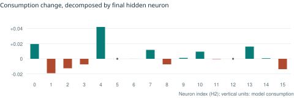
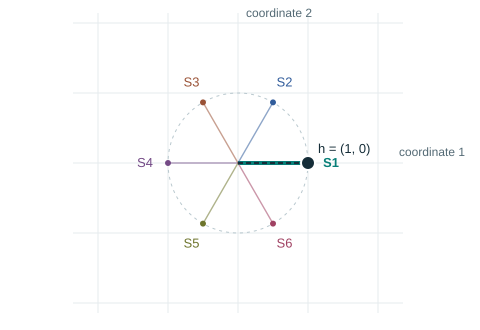
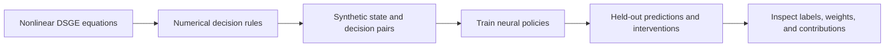

# das_neuron

**Economic equations, labelled neurons, and the computation between them.**

**New local experiment:** [five learned features in two hidden coordinates](learned_superposition.html) · [verified readout](learned_superposition_v2_readout.md).

[](learned_superposition.html)

[**Open the interactive policy circuit →**](https://strangeloopcanon.github.io/das_neuron/system.html) · [**Explore six features in two coordinates →**](https://strangeloopcanon.github.io/das_neuron/response_superposition.html) · [Read the short essay](output/blog/neuron-labels.html)

[](https://strangeloopcanon.github.io/das_neuron/system.html)

[](https://strangeloopcanon.github.io/das_neuron/response_superposition.html)

GitHub shows static previews here. Click either chart for the interactive controls, equations, and every weight.

## The question

What does knowing what a neuron tracks tell us about the system's computation?

The policy circuit exposes every weight, bias, activation rule, and measured neuron association. Move capital or change a shock. The labels stay fixed while gates, signed contributions, and cancellations change.

At the default state, a capital-associated neuron contributes **+0.01949** to consumption even though capital is held fixed. Across the final hidden layer, **+0.10048 − 0.06014 = +0.04034**. These are model consumption units, not percentages. The interactive trace reconstructs the response from all 16 terms.

## Equations → data → trained model → assessment



Households choose consumption, labour, and investment under productivity and work-discomfort shocks. Convex installation costs link current choices to future capital. Nine networks, with 387–4,611 parameters, learn the resulting decision rules at one calibration.

Labels use a separate DISCOVERY sample. Predictive accuracy uses TEST data. Neuron-removal effects use independent intervention states. The published plots retain approximation errors alongside the economic reference.

[Interactive policy circuit](https://strangeloopcanon.github.io/das_neuron/system.html) · [All nine networks](https://strangeloopcanon.github.io/das_neuron/richer.html) · [Economic equations, accuracy, and width results](richer_report.md) · [Contribution accounting](system_analysis_report.md)

## Six economic features in two coordinates

The new learned study uses **18 parameters**, fewer than the constructed circuit below. All five full-width controls learn all six features. Every two-coordinate compressed model retains five, confirmed on fresh data. The original all-six criterion remains unmet. [Read the learned result and confirmation](learned_superposition_v2_readout.md).

A second circuit gives an exact, **constructed superposition example**. Six independent growth economies supply six known consumption-response features. They share a two-dimensional linear representation:

$$h=Ex,\qquad \hat{x}=\operatorname{ReLU}(2E^\top h-\mathbf{1}).$$

The columns of E are the six directions of a regular hexagon. The decoder recovers all six single-sector responses exactly. Combining opposite directions cancels the representation, although both economic responses remain present.

- Exact reconstruction on all **7** baseline/singleton inputs.
- Predictable interference on all **15** two-sector inputs.
- A six-dimensional identity control reconstructs all **64** binary combinations.

The guarantee uses unit-amplitude singleton responses. Multiple shocks test outside that support. This circuit demonstrates designed feature sharing; it is separate from the trained policy networks above.

[Interactive superposition circuit](https://strangeloopcanon.github.io/das_neuron/response_superposition.html) · [Exact proof](constructive_superposition_proof.md) · [All weights and 64 cases](constructive_superposition.json) · [Separate learned-compression trial and controls](response_superposition_report.md)

## Run locally

Open `system.html`, `response_superposition.html`, or `output/blog/neuron-labels.html` directly in a browser. Each page is self-contained. No account, server, or network connection is needed for the controls.

To verify the saved evidence, install Python 3.13 and Node.js 22 or later:

```sh
python -m pip install -r requirements.txt
python -B verify_richer.py
python -B verify_system.py
python -B verify_response_superposition.py
python -B verify_constructive_superposition.py
python -B verify_learned_superposition_v2.py
node verify_richer_ui.js
node verify_system_ui.js
node verify_response_superposition_ui.js
node verify_learned_superposition_ui.js
```

The Python checks reconstruct the economic and neural calculations. The JavaScript checks execute the shipped controls and all 64 constructed-circuit states. They do not retrain models or claim browser layout coverage.

Original partitions are retained byte for byte in `richer_partitions.npz` and `response_partitions.npz`, checked against their original hashes. Economic outputs and sample amplitudes are independently recomputed with a numerical tolerance, so Mac/Linux rounding differences do not masquerade as changed data.

Rebuild the pages and essay from the saved results:

```sh
python build_system_page.py
python build_richer_page.py
python build_response_superposition_page.py
python build_learned_superposition_page.py
python build_blog.py
```

Training and teacher generation are separate scripts. They replace their corresponding result files when run. The frozen protocols, seeds, all saved models, and verification code are included.

The learned study is frozen in `learned_superposition_v2_protocol.json`. Its original six-feature result and later five-feature confirmation are separate files. `learned_superposition_v2.py --pilot` measures runtime before `--run` trains. The confirmation has no training step. To redraw the scientific figure, install `requirements-plots.txt` and run `build_learned_superposition_readout.py`.

## Reading

- [Blog: A neuron label is not a circuit explanation](output/blog/neuron-labels.html) · [Two-page PDF](output/pdf/neuron-labels.pdf)
- [Hilton et al., Understanding RL Vision](https://distill.pub/2020/understanding-rl-vision/)
- [Elhage et al., Toy Models of Superposition](https://transformer-circuits.pub/2022/toy_model/)

MIT licensed. Synthetic economic experiments; no real-world forecast claim.
