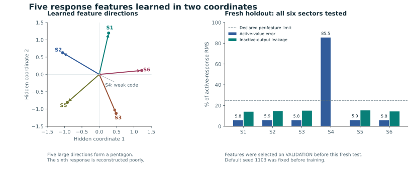

# Five learned features in two hidden coordinates

**The full-width training problem is fixed. All five 42-parameter controls learn all six responses. After compression and fine-tuning, all five 18-parameter networks retain five response features in two coordinates on singleton inputs.**

The fresh confirmation test gives retained-feature active-value errors of **5.81–5.93%**, combined inactive-output leakage of **14.08–15.88%**, and active-amplitude R² of **0.731–0.741**. It tests 4,096 new amplitudes for every sector, including the poorly reconstructed sector.

[Open the learned circuit](learned_superposition.html) · [Primary frozen protocol](learned_superposition_v2_protocol.json) · [All original outcomes](learned_superposition_v2_report.md) · [Fresh confirmation protocol](learned_superposition_v2_confirmation_protocol.json)



## What was trained

The economic teacher has logarithmic utility, Cobb–Douglas production and full capital depreciation. Each of six separate growth economies has the exact policy c=(1−αβ)zk^α and k′=αβzk^α. At fixed capital one, its normalized consumption response is x=(c−c₀)/c₀=z−1. The networks take the solved response vectors as data and reconstruct them. They are response-compression models, not new policy solvers. The underlying economic responses are additive.

The repaired network uses h=Wx and x̂=ReLU(Wᵀh+b). Sharing the encoder and decoder weights gives 42 trainable parameters for six hidden coordinates, then 18 for two coordinates. For each fixed seed, we train the six-coordinate model, project its learned encoder using an independently sampled orthogonal projection, reset the decoder bias to zero, then fine-tune on TRAIN. No hexagon, pentagon, feature angles, or feature-aligned initialization is supplied.

The full-width VALIDATION gate passed for every seed before any compressed training began. All five full-width TEST controls then passed. Their worst overall TEST relative RMSE is 5.35×10⁻⁸. Previous failed untied-weight runs remain intact.

## Original target and fresh confirmation

**The predeclared all-six-feature target failed: 0/5 compressed models passed it.** Every model reconstructed one feature poorly while retaining the other five. The five-feature finding was discovered after the original test. It is not reported as success on the original six-feature criterion.

We then froze a separate confirmation protocol. It fixes every model by hash and selects retained features using only the original VALIDATION criteria: active error ≤25%, combined inactive-output leakage ≤25%, and positive active-amplitude R². No model was retrained. The fresh dataset uses a new seed and 24,576 positive rows disjoint from every original partition. All five selected features passed for all five models. All six features were evaluated and remain in the results.

| Seed | Full-width TEST | Confirmed features | Poorly reconstructed sector | Retained-feature active error | Retained-feature amplitude R² |
|---:|---|---:|---|---:|---:|
| 1103 | True | 5/6 | S4 | 5.81–5.93% | 0.732–0.741 |
| 2207 | True | 5/6 | S4 | 5.84–5.89% | 0.734–0.741 |
| 3301 | True | 5/6 | S3 | 5.82–5.88% | 0.734–0.740 |
| 4409 | True | 5/6 | S5 | 5.82–5.93% | 0.731–0.740 |
| 5519 | True | 5/6 | S2 | 5.82–5.85% | 0.739–0.741 |

The denominator is active-response RMS, not the level of economic consumption. Leakage combines all five inactive outputs. Amplitude R² is computed only on active examples, so an output that merely identifies the sector and emits a constant cannot pass.

## What the two neurons contain

For the default seed, the hidden coordinates are approximately:

```text
h1 = 0.271 S1 − 1.052 S2 + 0.485 S3 − 0.003 S4 − 0.919 S5 + 1.222 S6
h2 = 1.196 S1 + 0.624 S2 − 1.126 S3 − 0.005 S4 − 0.809 S5 + 0.113 S6
```

Here S1–S6 are the known sector-response inputs. The retained features use five distinct directions in the same two-dimensional space. Their consecutive angular gaps lie close to 72 degrees in every seed, a learned pentagon. These directions and angles are descriptive observations after training, not an imposed template or original acceptance criterion. The sixth direction is very small; its decoder mostly emits a poor constant response.

Five distinct, independently controlled response features remain selectively recoverable through two shared coordinates. That is the evidence for learned superposition in this experiment. Individual hidden coordinates mix those economic features. The result does not depend on calling a correlation a complete neuron meaning.

## Changes to the circuit

The saved intervention tests insert and remove each feature direction in latent space, decode the edited vector, measure target reconstruction, and measure changes to unaffected outputs. Separate coordinate ablations show how removing either hidden coordinate affects several sector responses. Encoding equality alone follows from the linear encoder; the measured decoder selectivity is the substantive result.

On simultaneous shocks, both the full-width and compressed models can fail because their training support contains only zero and singleton responses. Compressed pair-response RMSE is about 74%, versus 25–35% for matched full-width controls. These are distribution-shift results. The economic teacher remains additive. Pair failures should not all be attributed to compression.

## Verification and execution

The training run took 5.75 seconds of local CPU time. All five seeds are shown. The original protocol, numerical source, data archive and weights are hashed. The independent verifier imports no training module and reconstructs outputs, accuracy, geometry, projection ancestry, baselines, intervention effects, flags and the fresh confirmation. No old experiment or public deployment was replaced.

```sh
python -B verify_learned_superposition_v2.py
node verify_learned_superposition_ui.js
```

This establishes learned feature sharing in a small circuit. Difficulty of human understanding is a separate measurement; this study did not test it.
